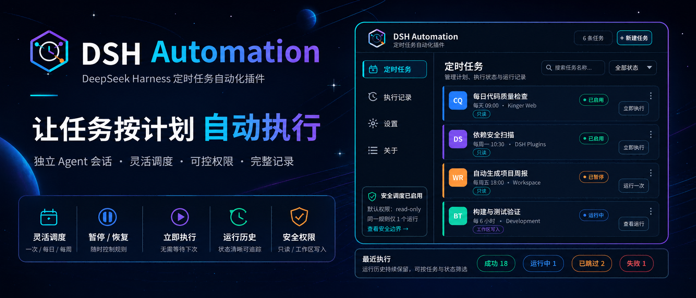
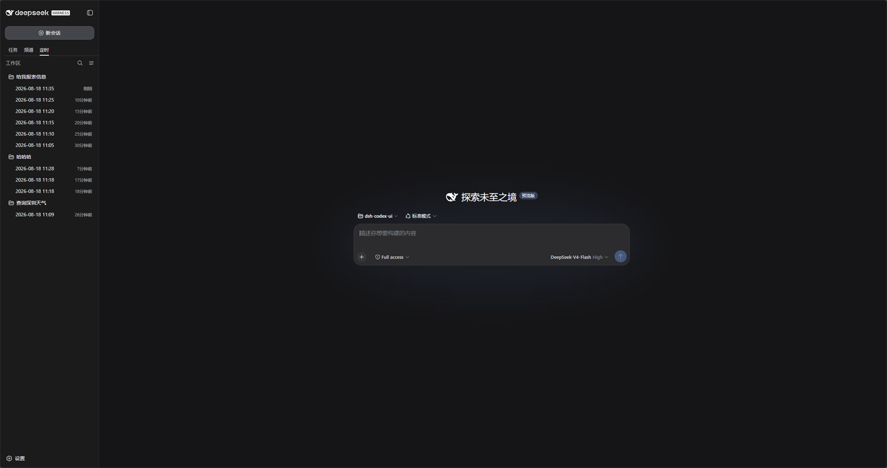
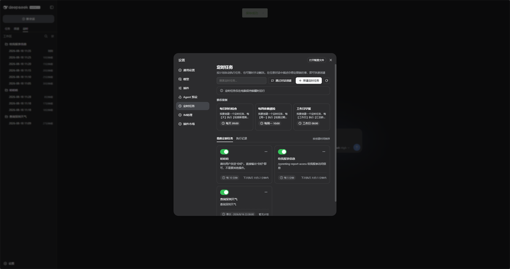
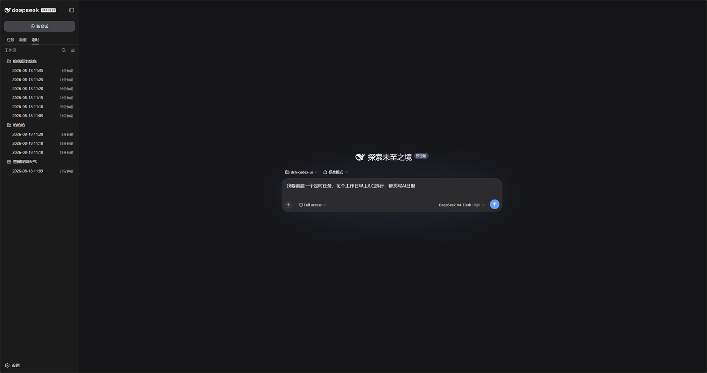
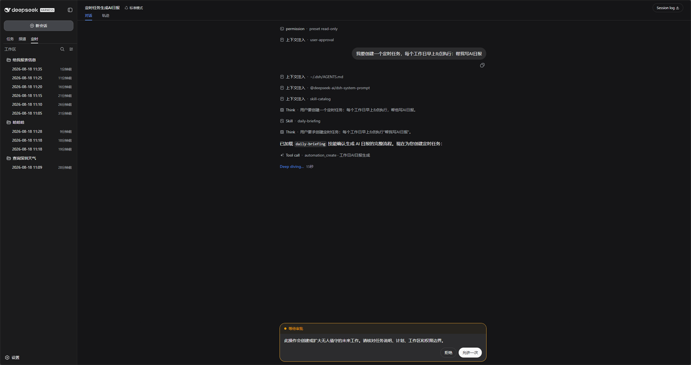
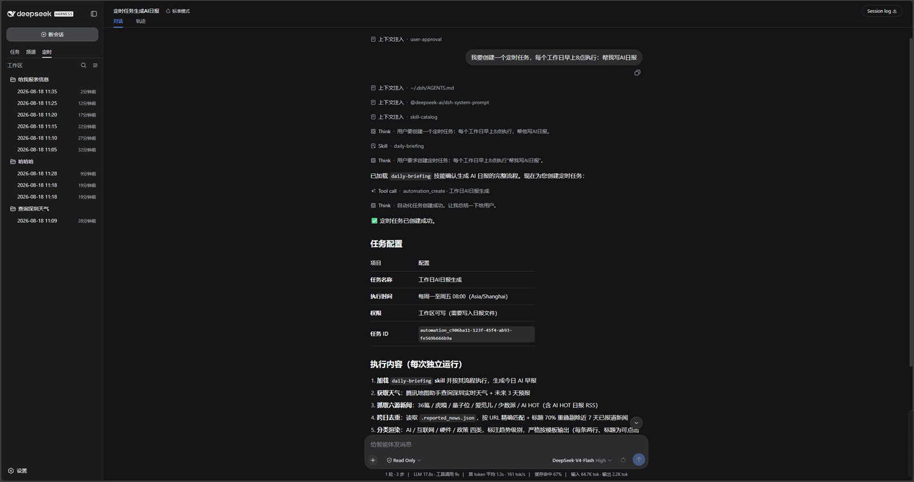
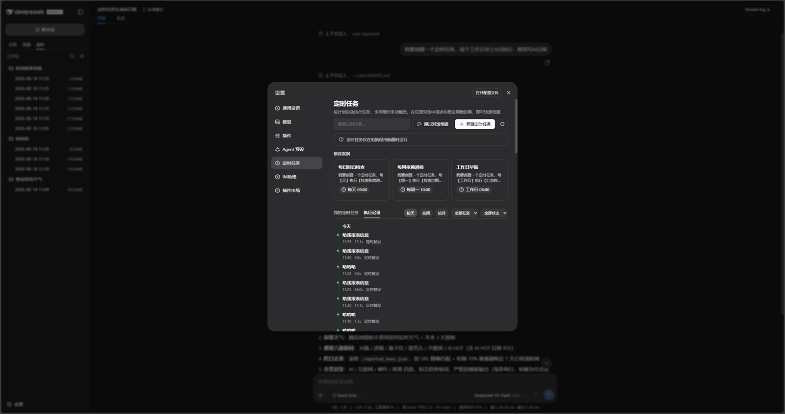

<p align="center">
  
</p>

<div align="center">

  # DSH Automation

  **Exécutez des tâches de programmation autonomes selon un calendrier dans DeepSeek Harness**

  [简体中文](README.zh-CN.md) · [English](README.en.md) · [日本語](README.ja.md) · [Español](README.es.md) · [Français](README.fr.md) · [Deutsch](README.de.md) · [Русский](README.ru.md) · [Português](README.pt.md)

  [Journal des modifications](CHANGELOG.md) · [Apache-2.0](LICENSE)

  [](LICENSE)
  [](https://www.npmjs.com/package/@michengai/dsh-automation)
  [](https://www.npmjs.com/package/@michengai/dsh-automation)
  [](https://github.com/MichengAI/dsh-automation)
  [](https://nodejs.org/)
</div>

> DSH Automation est un plugin communautaire pour DeepSeek Harness (DSH), et n'est pas un produit officiel de DeepSeek AI.

## Présentation des fonctionnalités

Confiez à DSH les tâches répétitives récurrentes. Configurez des tâches dans les paramètres ou décrivez vos exigences dans une conversation, puis consultez les résultats de chaque exécution.

- **Exécution unique ou récurrente** : intervalles (en minutes), toutes les heures, tous les jours, toutes les semaines, tous les mois ou tous les X jours.
- **Environnement de travail flexible** : configurez le dossier de travail, le modèle, les compétences et les limites d'autorisations.
- **Ajustement du calendrier à tout moment** : créez, suspendez, reprenez, exécutez immédiatement ou supprimez des tâches.
- **Examen des résultats** : parcourez les conversations par nom de tâche et heure d'exécution dans l'onglet **Planifié**, ou filtrez l'historique dans les paramètres.
- **Sessions indépendantes** : chaque exécution démarre dans une nouvelle session avec les instructions enregistrées, sans hériter du contexte de création.
- **Interface en 8 langues** : français, anglais, chinois, japonais, espagnol, allemand, russe et portugais, s'alignant sur la langue globale de DSH (requiert DSH `0.2.2-rc.1` ou supérieur pour les langues autres que chinois/anglais).

## Aperçu de l'interface

Les sessions planifiées apparaissent à la fois dans l'arborescence officielle des **Tâches** et dans l'onglet **Planifié**. Les sessions inactives affichent l'icône d'horloge officielle. L'affichage **Planifié → Historique** regroupe par défaut les éléments par tâche, avec bascule possible par espace de travail, arborescence ou liste plate. Le mode par espace de travail conserve les espaces visibles et filtre les sessions planifiées ; l'icône « + » de l'en-tête permet de créer directement une tâche :



Ouvrez **Paramètres → Tâches planifiées** pour rechercher, créer, suspendre et inspecter vos règles :



Décrivez la tâche dans le chat. DSH traitera l'approbation selon le mode d'autorisation sélectionné :





Après validation, la règle est enregistrée et résumée dans la conversation :



L'historique d'exécution reste disponible dans les paramètres et peut être filtré par jour, semaine, mois, tâche ou statut :



## Écosystème des produits DSH

Pour un environnement de bureau complet, téléchargez [DSH Codex Desktop](https://github.com/MichengAI/dsh-codex-desktop/releases). Pour une installation existante de [DeepSeek Harness](https://github.com/deepseek-ai/deepseek-harness), ajoutez les plugins selon vos besoins :

| Plugin | Ce que vous pouvez faire |
| --- | --- |
| [Codex UI](https://github.com/MichengAI/dsh-codex-ui) | Organiser les projets et conversations, rechercher des tâches et naviguer dans les échanges |
| [Agency Agents](https://github.com/MichengAI/dsh-agency-agents) | Sélectionner et invoquer des agents spécialistes adaptés à vos missions |
| [Skills Manager](https://github.com/MichengAI/dsh-skills-manager) | Gérer, activer, créer et importer vos compétences locales |
| [Archive Manager](https://github.com/MichengAI/dsh-archive-manager) | Rechercher, restaurer ou nettoyer les conversations archivées |
| [IM Connect](https://github.com/MichengAI/dsh-im-connect) | Envoyer des tâches et recevoir des réponses via des plateformes de messagerie |
| [Automation](https://github.com/MichengAI/dsh-automation) | Planifier des tâches autonomes et examiner chaque rapport d'exécution |
| [BTW](https://github.com/MichengAI/dsh-btw) | Poser des questions contextuelles rapides sans interrompre la tâche principale |
| [Simplify](https://github.com/MichengAI/dsh-simplify) | Utiliser `/simplify` pour nettoyer et optimiser le code de vos modifications Git |
| [PUA](https://github.com/MichengAI/dsh-pua) | Guider l'agent pour explorer de nouvelles approches en cas d'échec et vérifier avant clôture |
| [Code Review](https://github.com/MichengAI/dsh-code-review) | Utiliser `/review` pour demander une revue de code indépendante par un agent |
| [Codex Pet](https://github.com/MichengAI/dsh-codex-pet) | Consulter les notifications et répondre aux demandes d'outils via un animal de bureau |

## Prérequis

- Compatibilité hôte : gamme complète DeepSeek Harness `0.2.x` (`>=0.2.0-rc.1 <0.3.0-0`), validée sur `0.2.0-rc.1`, `0.2.0-rc.2`, `0.2.1-rc.1`–`0.2.1-rc.5` et `0.2.2-rc.1`, compatible avec les versions RC futures. Les hôtes sous `0.1.x` doivent conserver le plugin `0.1.66`. Sauvegardez le stockage et les sessions de l'automatisation avant toute mise à niveau ; `0.2.0` enregistre les sessions en V4, qui ne peuvent plus être lues après un retour en arrière.
- Les peerDependencies officielles acceptent la plage génrationnelle `>=0.2.0-rc.1 <0.3.0-0`. Les dépendances de développement sont figées sur `0.2.2-rc.1`. Les versions antérieures et ruptures en `0.3.0` sont rejetées par le filtre de version. `@deepseek-ai/dsh-agent-presets` et `@deepseek-ai/dsh-agent-preset-registry` ne sont pas des pairs, mais exploitent le service hôte `agentPresets`.
- Les autres versions sortent du cadre de compatibilité garanti.
- Le bundle ne modifie pas l'entrée officielle Connection. Chaque hôte conserve ses dépendances et sa configuration ; l'automatisation déclare son canal RPC dans sa propre portée.
- Une installation fonctionnelle de DeepSeek Harness Web avec la commande `dsh` accessible dans PowerShell.
- Les exemples utilisent le profil `web` ; adaptez-le selon votre configuration.
- Node.js 22.19+ pour le développement et la compilation locale.

## Installation

Les commandes d'installation ci-dessous utilisent le registre npm officiel.

### Demander à un agent de l'installer (recommandé)

Envoyez l'instruction suivante à tout agent disposant des droits d'exécution de terminal (remplacez `web` par votre profil) :

```text
Installe le plugin DSH @michengai/dsh-automation dans mon profil web local en exécutant : dsh plugin --profile web add @michengai/dsh-automation@latest --registry=https://registry.npmjs.org/. Exécute ensuite dsh --profile web --dump-config, confirme que la configuration contient dsh-automation et explique-moi comment recharger DSH pour l'utiliser.
```

### Installation directe depuis npm

```powershell
[Console]::OutputEncoding = [System.Text.Encoding]::UTF8
$OutputEncoding = [System.Text.Encoding]::UTF8
dsh plugin --profile web add @michengai/dsh-automation@latest --registry=https://registry.npmjs.org/
dsh --profile web --dump-config
```

Redémarrez DSH Web et actualisez la page du navigateur (Ctrl+F5). Spécifiez une version fixe telle que `@0.1.5` au lieu de `@latest` si nécessaire.
- **Déploiement derrière proxy inverse** : Prise en charge des préfixes de chemin (ex. `/app/dsh/`). Les API sont résolues relativement à `document.baseURI`.

## Configuration et commutateurs du plugin

Accédez à :
> **Barre latérale → Plugins → Détails de `@michengai/dsh-automation`** (emplacement `plugins.bundle.config` de l'hôte).

Deux commutateurs natifs et un sélecteur d'emplacement sont mis à disposition :

### 1. Entrée dans la barre latérale (`sidebarEntry`)
- **Par défaut** : Activé (`true`) / Prise en charge fluide dès l'installation
- **Description** : Affiche une icône dédiée **Tâches planifiées** dans la barre d'activité principale.
- **Effet** :
  - **Vue centrée de 960px** : Ouvre le centre de gestion dans un conteneur large de 960px, évitant le défilement étroit dans les fenêtres modales.
  - **Désenregistrement propre** : Désactiver le commutateur libère l'emplacement proprement et repositionne l'affichage si le panneau était ouvert.
  - **Synchronisation en direct** : Le dialogue standard des paramètres et les onglets du rail restent pleinement synchronisés.

### 2. Masquer l'entrée d'automatisation officielle (`hideOfficialSchedule`)
- **Par défaut** : Activé (`true`, coordonné avec l'entrée de la barre latérale)
- **Description** : Masque l'entrée « Tâches d'automatisation » (`ui-schedule`) intégrée de l'hôte pour éviter les doublons.
- **Effet** :
  - **Remplacement transparent** : L'entrée officielle est masquée par défaut pour ne laisser place qu'à celle du plugin.
  - **Réinitialisation intelligente du panneau** : Si le volet principal affichait l'ancien panneau d'automatisation, il revient automatiquement au chat par défaut.
  - **Cache persistant sans scintillement** : La mémoire locale du client empêche tout clignotement d'icône, même sur réseau lent.
  - **Restauration immédiate** : La désactivation ou la désinstallation restaure l'entrée native sans délai.
  - **Sécurité des mises à niveau** : Pour un utilisateur ayant désactivé `sidebarEntry`, l'entrée officielle reste visible pour éviter toute barre vide.

### 3. Afficher les sessions planifiées dans l'arborescence des tâches (`taskTreeSessions`)
- **Par défaut** : Désactivé (`false`, masque les sessions planifiées dans l'arborescence)
- **Description** : Détermine si les sessions planifiées apparaissent dans l'arborescence principale des espaces de travail.
- **Effet** :
  - **Réduction du bruit** : Les sessions planifiées sont filtrées hors de l'arbre principal, préservant la clarté du travail quotidien.
  - **Consultation sans perte** : Toutes les exécutions passées demeurent accessibles dans « Planifié → Historique ».
  - **Protocole inter-plugins léger** : Respecte le contrat `NativeTabRegistry.sessionFilters` sans interception invasive du système hôte.

### 4. Configuration `cordis.patch.yml`
```yaml
- id: dsh-automation
  name: '@michengai/dsh-automation'
  config:
    stateDir: D:/Data/dsh-automation   # Facultatif : dossier de stockage des configurations
    runTimeoutMinutes: 60              # Facultatif : délai d'expiration en minutes (défaut : 60, max : 1440)
    misfireGraceMinutes: 15            # Facultatif : tolérance pour les lancements manqués en minutes (défaut : 15)
    historyLimit: 200                  # Facultatif : nombre d'enregistrements d'historique conservés (défaut : 200)
    updater: false                     # Facultatif : verrouillage des mises à jour en entreprise (alias : onlineUpdate: false)
```

## Mise à jour

Le bouton de mise à jour dans les paramètres du plugin a été supprimé. Pour mettre à jour, réinstallez la dernière version dans le même profil avec la commande `dsh plugin … add @latest`, redémarrez DSH et actualisez le navigateur. En entreprise, `updater: false` ou `onlineUpdate: false` dans Cordis permet de bloquer les requêtes de mise à jour (HTTP 403).

## Utilisation

Ouvrez **Paramètres → Tâches planifiées** :

| Objectif | Action | Portée |
| --- | --- | --- |
| Créer une règle | Cliquez sur **Nouvelle tâche**, puis réglez le nom, le calendrier, le prompt, l'espace, le modèle et les permissions | Tout l'hôte |
| Créer depuis le chat | Décrivez le calendrier dans une conversation ou cliquez sur **Créer dans le chat** | Conversation en cours |
| Suspendre / reprendre | Utilisez le commutateur sur la carte de la tâche | Une seule règle |
| Exécuter maintenant | Ouvrez le menu de la carte et choisissez **Exécuter maintenant** | Une seule règle |
| Supprimer | Ouvrez le menu de la carte et choisissez **Supprimer la tâche** (historique conservé) | Définition uniquement |
| Consulter l'historique | Ouvrez **Historique des exécutions** et filtrez par date ou statut | Tout l'hôte |

Chaque exécution utilise le prompt, le dossier, le modèle et les permissions enregistrés, sans réutiliser les validations de la conversation d'origine.

`automation_create` et `automation_update` gèrent les mêmes paramètres de modèle que l'interface (`provider`, `model`, `reasoning_effort`). Lors de la spécification ou de la mise à jour d'un modèle, transmettez `provider` et `model` comme une paire d'identifiants non vides ou tous deux à `null` pour suivre la configuration globale ; les paires incomplètes sont rejetées. `automation_list` renvoie par défaut les métadonnées et le résumé de `lastRun` (statut, horodatage, `summary` ≤240 caractères, erreur) sans renvoyer le texte intégral de `prompt` (indique `promptChars` à la place) ; passez `include_prompt: true` lorsque le texte intégral de l'instruction est requis.

## Limites de sécurité

| Élément | Comportement |
| --- | --- |
| Permissions | Les options et les valeurs par défaut proviennent directement du service officiel `permissionPresets` de l'hôte, y compris les préréglages personnalisés. |
| Préréglage d'Agent | Sélectionné depuis le registre `agentPresets` de l'hôte lors de la création/modification ; les cartes affichent le préréglage actuel et l'historique consigne celui réellement utilisé. Les préréglages corrompus sont désactivés. |
| Appels d'outils | Respectent les vérifications de disponibilité, de permissions et d'approbations de l'hôte sans liste blanche fixe ni interdiction de shell en arrière-plan. Les processus d'arrière-plan sont gérés par l'hôte. |
| Accès complet | L'option officielle `danger-full-access` affiche la même confirmation de risque et le même avertissement orange que le Chat. |
| Approbations | La création via le chat suit la politique de la session. L'accès complet (`never`) s'exécute directement ; Workspace Write / Read Only (`ask`) affiche la carte officielle. Les exécutions sans surveillance restent en `never` (fail-closed). |
| Nouvelles tentatives | Aucune nouvelle tentative automatique après le démarrage d'une exécution. |
| Redémarrage de l'hôte | Les exécutions en attente dans `queued` ou `running` basculent vers `failed(host_interrupted)`. |
| Concurrence globale | Aucune limite de concurrence globale au niveau du plugin entre différentes tâches, même dans le même dossier. L'ancien paramètre global du plugin (`maxConcurrentRuns` dans la configuration) n'a plus d'effet et est distinct du champ par tâche ci-dessous. |
| Intervalle minimum | Depuis `0.1.40`, les planifications par intervalle acceptent des minutes entières à partir de `1`. Les déclenchements manqués ne sont pas rejoués individuellement ; seule la dernière échéance dans la fenêtre de récupération est traitée. |
| Concurrence par tâche | Disponible depuis `0.1.40`. Définit les exécutions simultanées dans le dialogue (entier positif, valeur par défaut `1`). Les exécutions en file d'attente et en cours partagent cette limite. À saturation, les déclenchements programmés passent en `skipped(overlap)` et les lancements manuels retournent une erreur de limite. Réduire la limite n'annule pas les exécutions en cours. Les outils d'Agent acceptent `max_concurrent_runs`, le RPC Web accepte `maxConcurrentRuns` ; les tâches existantes utilisent `1` par défaut. |
| Confinement de l'espace de travail | Lié par défaut au dossier de la session source. Les outils d'Agent peuvent spécifier ou migrer des tâches via `workspace` (nom, ID, chemin ou nom du dossier) ; les modifications entre espaces (`update` / `run_now` / `delete`) nécessitent explicitement `cross_workspace: true` pour empêcher les fuites non autorisées ; `automation_list` prend en charge `all_workspaces: true`. |

Une planification consigne une intention future, et ne constitue pas une concession d'autorisation mise en cache.

## Développement

### Installation depuis les sources

```powershell
[Console]::OutputEncoding = [System.Text.Encoding]::UTF8
$OutputEncoding = [System.Text.Encoding]::UTF8
Set-Location D:\Repository\deepseek-harness-plugin
git clone https://github.com/MichengAI/dsh-automation.git
Set-Location .\dsh-automation
pnpm install
pnpm test
pnpm build
dsh plugin --profile web add .
dsh --profile web --dump-config
```

Redémarrez DSH Web et actualisez le navigateur.

Le code source réside dans `src` et est compilé dans `lib` :

- [src\index.ts](src/index.ts) : Plugin hôte, outils et RPC.
- [src\service.ts](src/service.ts) : Définitions persistantes, horloge et admission des exécutions.
- [src\client\index.ts](src/client/index.ts) : Page des paramètres et préremplissage du chat.
- `tests\*.test.ts` : Tests de domaine, de récurrence, de service, de client et de contrat de package.

L'installation locale lit et applique `cordis.patch.yml` ; ne copiez pas manuellement les fichiers de `lib`.

Après avoir modifié des fichiers, lancez les tests, recompilez et réinstallez depuis le dossier local :

```powershell
[Console]::OutputEncoding = [System.Text.Encoding]::UTF8
$OutputEncoding = [System.Text.Encoding]::UTF8
pnpm check
dsh plugin --profile web add .
```

Conservez la politique de distribution au plus une fois, le confinement par défaut de l'espace de travail avec gardes explicites (cross_workspace / all_workspaces) et l'approbation fail-closed pour les exécutions sans surveillance.

## Vérification

```powershell
[Console]::OutputEncoding = [System.Text.Encoding]::UTF8
$OutputEncoding = [System.Text.Encoding]::UTF8
pnpm test
pnpm build
```

`pnpm check` regroupe la validation de types, les tests unitaires, la compatibilité hôte et la compilation. `pnpm test:host` contourne les doublures et exploite l'AgentLoop officiel, Session V3 et le service d'autorisations avec un adaptateur de modèle local sans appel réseau externe. Les interactions dans le navigateur et les appels aux modèles réels nécessitent des tests d'acceptation distincts.

Les régressions de barre latérale entre plugins sont testées avec `pnpm test:composition <dossier dsh-im-connect>`. Compilez d'abord le checkout IM ; le script lit son `lib/client.js`. Il exécute la logique de composition et les registres d'onglets des deux dépôts, couvrant l'ordre d'enregistrement, les notifications différées et la reprise lors de la désinstallation à travers les plugins d'archives, IM, programmés et Codex UI. Les emplacements et minuteurs utilisent un environnement simulé ; ce test n'installe aucun plugin et ne remplace pas les tests d'acceptation de rendu sur Desktop. Cette vérification distincte nécessite un dossier externe et n'est pas incluse dans `pnpm check` ; utilisez une révision fixe d'IM pour des résultats reproductibles.

`pnpm test:matrix` compile le package puis crée des environnements npm temporaires distincts pour chaque version d'hôte déclarée en utilisant l'accès réseau. Il vérifie l'installation stricte des pairs, chaque version de dépendance officielle, le point d'entrée packagé, l'exécution réelle d'AgentLoop et les régressions de service. Toutes les versions déclarées réussissent. L'énumération de persistance dans les régressions de service utilise des fixtures en mémoire pour les deux formats de session à froid ; elle ne valide pas la migration sur disque d'un profil réel. Le dossier de preuves conserve les fichiers de verrouillage d'installation, les journaux de test et `results.json`. La matrice ne modifie pas les dépendances de développement et ne se connecte pas au profil de l'utilisateur.

## Licence

Distribué sous [Licence Apache 2.0](LICENSE).
