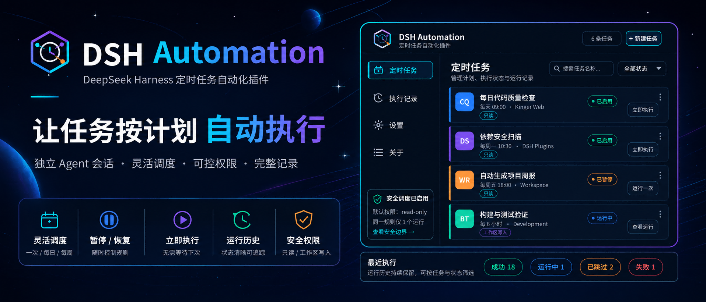
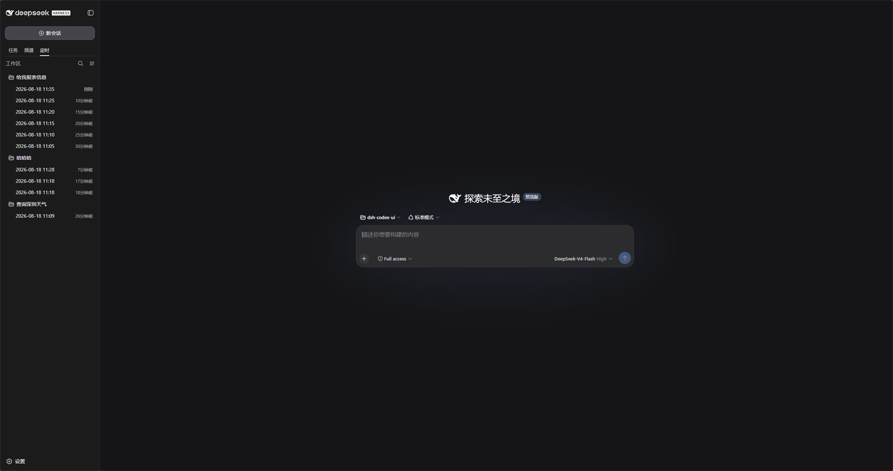
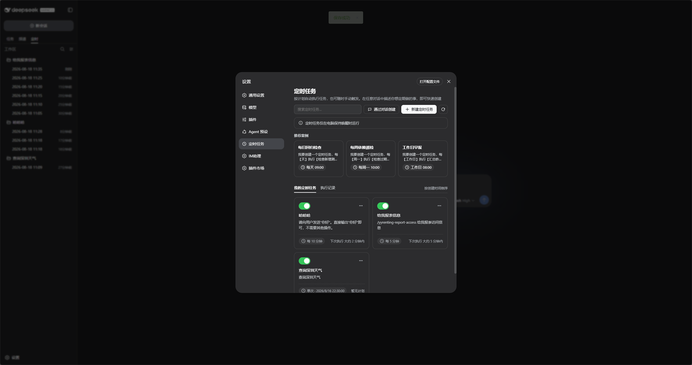
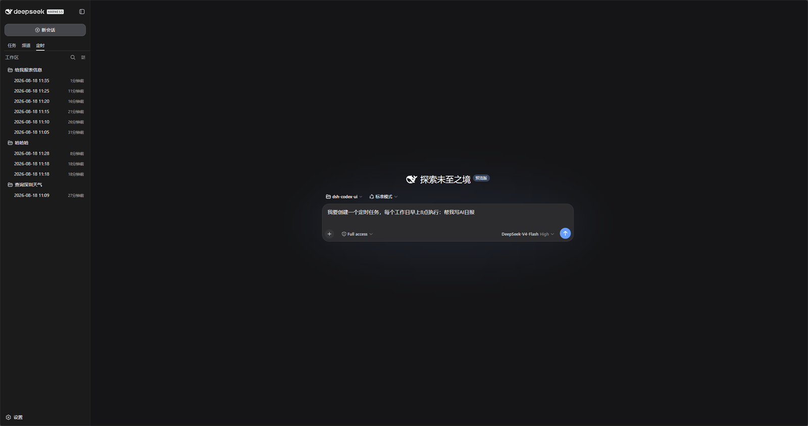
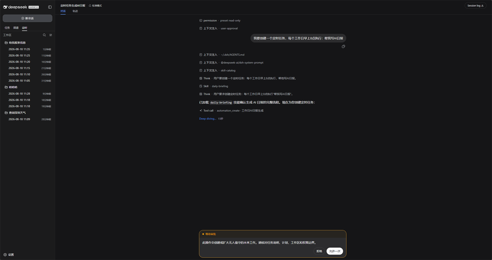
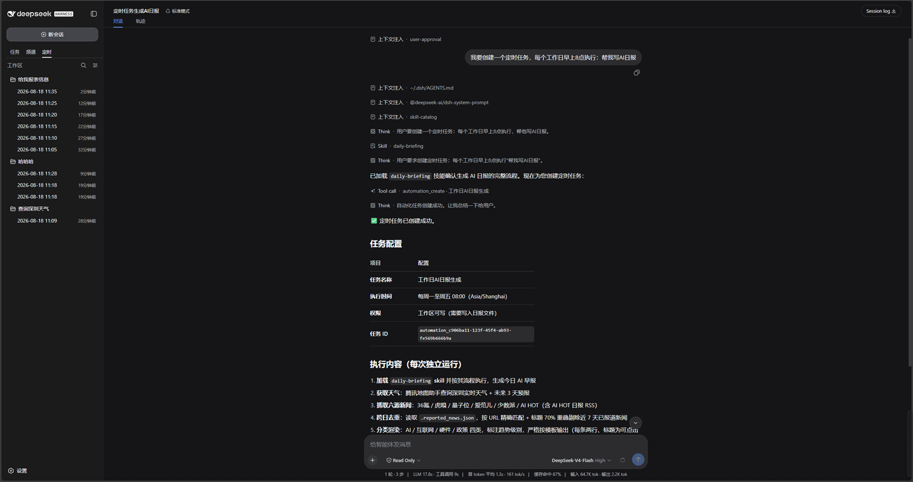
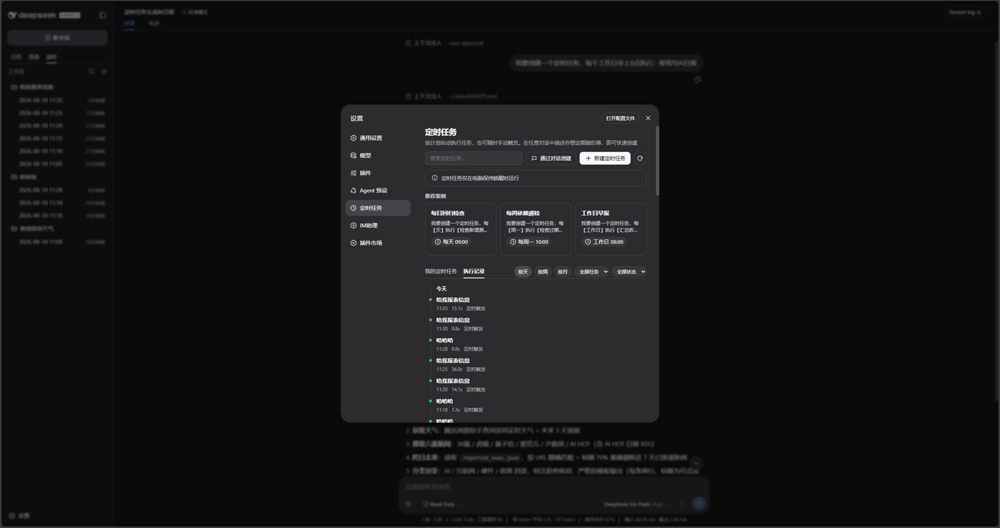

<p align="center">
  
</p>

<div align="center">

  # DSH Automation

  **Run standalone coding tasks on a schedule in DeepSeek Harness**

  [简体中文](README.zh-CN.md) · [Changelog](CHANGELOG.md) · [Apache-2.0](LICENSE)

  [](LICENSE)
  [](https://www.npmjs.com/package/@michengai/dsh-automation)
  [](https://www.npmjs.com/package/@michengai/dsh-automation)
  [](https://github.com/MichengAI/dsh-automation)
  [](https://nodejs.org/)
</div>

> DSH Automation is a community-maintained DeepSeek Harness (DSH) plugin, not an official DeepSeek AI product.

## Features

Let DSH handle work on a schedule. Set up tasks in Settings or describe the timing and requirements in a conversation, then review each run.

- **Run once or repeat**: choose intervals, hourly, daily, weekly, monthly, or every N days.
- **Choose the working environment**: set the directory, model, skills, and permissions.
- **Adjust the schedule anytime**: create, pause, resume, run immediately, or delete tasks.
- **Review results**: browse task conversations by name and run time in the **Scheduled** tab, or filter run history in Settings.
- **Keep each run independent**: each run uses the saved task instructions and does not inherit the conversation that created it.

## Interface

Scheduled sessions appear in both the official **Tasks** tree and the **Scheduled** tab. Idle scheduled sessions show the official clock icon in **Tasks**. **Scheduled → Records** groups by task by default and can switch to By workspace, Workspace tree, or Flat. By workspace keeps workspaces visible and only filters sessions to scheduled runs; the header + opens New scheduled task directly. Those groups cannot be added, renamed, or deleted:



Open **Settings → Scheduled Tasks** to search, create, pause, and inspect rules:



Describe the job in chat. DSH handles approval according to the selected permission mode:





After approval, the rule is saved and summarized in the conversation:



Run history stays in Settings and can be filtered by day, week, month, task, or status:



## DSH product ecosystem

For a desktop workbench, download [DSH Codex Desktop](https://github.com/MichengAI/dsh-codex-desktop/releases). Existing [DeepSeek Harness](https://github.com/deepseek-ai/deepseek-harness) installations can add plugins as needed by following each project's README. Below are 11 first-party plugins; consult the corresponding desktop release notes and bundled catalog for what that version includes.

| Plugin | What you can do |
| --- | --- |
| [Codex UI](https://github.com/MichengAI/dsh-codex-ui) | Organize projects and conversations, search tasks, and navigate chat turns |
| [Agency Agents](https://github.com/MichengAI/dsh-agency-agents) | Choose and summon specialists for your task |
| [Skills Manager](https://github.com/MichengAI/dsh-skills-manager) | Find, enable, create, and import local skills |
| [Archive Manager](https://github.com/MichengAI/dsh-archive-manager) | Search, restore, or clean up archived conversations |
| [IM Connect](https://github.com/MichengAI/dsh-im-connect) | Send tasks and receive replies through messaging platforms |
| [Automation](https://github.com/MichengAI/dsh-automation) | Schedule tasks and review each run |
| [BTW](https://github.com/MichengAI/dsh-btw) | Ask side questions without interrupting the main task |
| [Simplify](https://github.com/MichengAI/dsh-simplify) | Use `/simplify` to improve code within your Git changes |
| [PUA](https://github.com/MichengAI/dsh-pua) | Guide the Agent to try new approaches after failures, investigate causes, and verify results before completion |
| [Code Review](https://github.com/MichengAI/dsh-code-review) | Use `/review` to request an independent Agent code review and receive the report in the current conversation |
| [Codex Pet](https://github.com/MichengAI/dsh-codex-pet) | View conversation notifications and respond to tool approvals and questions through a desktop pet |

## Prerequisites

- The current source uses DSH `0.2.1-rc.2` for development and real Host compatibility tests, and declares support for `0.2.0-rc.1`, `0.2.0-rc.2`, `0.2.1-rc.1`, `0.2.1-rc.2`, and `0.2.1-rc.3`. Hosts still on `0.1.x` should stay on plugin `0.1.66`. Back up automation storage and sessions in the Profile before upgrading the Host. `0.2.0` writes V4 sessions, and V4 sessions cannot be read after downgrading.
- Official DSH peerDependencies are exactly `0.2.0-rc.1 || 0.2.0-rc.2 || 0.2.1-rc.1 || 0.2.1-rc.2 || 0.2.1-rc.3`. Intermediate `0.2.1-alpha` releases are no longer supported. `0.1.x` is no longer supported because the current UI uses host primitives that those hosts do not provide. `@deepseek-ai/dsh-agent-presets` and `@deepseek-ai/dsh-agent-preset-registry` are not peers: scheduled tasks use the host `agentPresets` service, and the install gate checks every `@deepseek-ai/dsh-*` peer against the running version. Development dependencies are pinned to `0.2.1-rc.2`. Use one consistent official package version within each Host.
- Other versions are outside the declared compatibility range. Installers may warn, and strict peer validation rejects them. Extend and pass the version matrix before adding a new rc.
- The automation bundle does not override the official Connection entry. Each Host keeps its own startup dependencies, trusted-host expressions, and custom configuration; automation registers its RPC channel in its own plugin scope.
- A working DeepSeek Harness Web installation with `dsh` available in PowerShell.
- Examples use the `web` profile; replace it with the target profile.
- Source installation and development require Node.js 22.19+. npm installation does not require running `npm install` in an arbitrary directory.

## Installation

The installation commands below use the official npm registry.

### Ask an agent to install it (recommended)

Send the prompt below to any agent that can run terminal commands on your computer. Replace `web` with your actual profile. Once installed, use the plugin in DSH.

```text
Install the DSH plugin @michengai/dsh-automation into my local web profile by running: dsh plugin --profile web add @michengai/dsh-automation@latest --registry=https://registry.npmjs.org/. Then run dsh --profile web --dump-config, confirm the configuration includes dsh-automation, and explain how to reload DSH and start using the plugin.
```

### Install from npm

```powershell
[Console]::OutputEncoding = [System.Text.Encoding]::UTF8
$OutputEncoding = [System.Text.Encoding]::UTF8
dsh plugin --profile web add @michengai/dsh-automation@latest --registry=https://registry.npmjs.org/
dsh --profile web --dump-config
```

Restart DSH Web and hard-refresh the browser. Pin a version with `@0.1.5` instead of `@latest` when needed.
- **Reverse Proxy Deployment**: Supports running DSH behind a reverse proxy with a path prefix (e.g. `/app/dsh/`). Plugin API and update check endpoints resolve relative to the document base URI (`document.baseURI`) to avoid 404 errors caused by stripped path prefixes.

## Plugin Configuration & Toggles

The plugin follows standard DSH bundle configuration conventions. Options are located at:
> **Sidebar → Plugins → Click `@michengai/dsh-automation` details** (the host's `plugins.bundle.config` slot).

Three native switches are available:

### 1. Sidebar Entry (`sidebarEntry`)
- **Default**: Enabled (`true`) / Seamless takeover on new installs
- **Description**: Displays a dedicated **Scheduled Tasks** icon on the primary activity bar.
- **Effect**:
  - **960px Centered View**: When enabled, clicking the sidebar icon opens the full task center inside a **960px centered container** (matching host plugin manager conventions). This eliminates vertical scrolling constraints in narrow settings dialogs, providing ample room for multi-step prompts, schedules, and audit records;
  - **Clean Unregister**: When toggled off, cleanly unregisters the slot and safely switches away if the panel was active;
  - **Live Synchronization**: The standard Settings modal and the workspace rail tabs remain fully available and in sync regardless of this toggle.

### 2. Online Updates (`onlineUpdate` / `updater`)
- **Default**: Enabled (`true`)
- **Description**: Controls whether the plugin checks for and installs updates from npm.
- **Effect**:
  - **Dynamic UI Sync**: Disabling the toggle hides update chips and check buttons from the settings header immediately without requiring a full page reload;
  - **Endpoint Guard**: When disabled, the update API route returns `HTTP 403` for all check and install requests, preventing unreviewed updates;
  - **Host / Platform Lock**: For curated plugin indexes (such as VibeDev) or restricted enterprise environments, this can be locked directly via Cordis configuration (bundle patch) without needing UI interaction:
    ```yaml
    updater: false # or onlineUpdate: false
    ```
    Once configured, the built-in updater is disabled at startup and the UI toggle is disabled with a locked notice;
  - **Update Mode**: When an update is detected, **Update automatically** runs only when the DSH CLI or Desktop update service is available; otherwise, the dialog provides a profile-specific manual command to copy and run.

### 3. Hide Official Automation Entry (`hideOfficialSchedule`)
- **Default**: Enabled (`true`, paired with Sidebar Entry)
- **Description**: Controls whether to hide the host's built-in "Automation tasks" (`ui-schedule`) entry to avoid conflict.
- **Effect**:
  - **Clean Sidebar & Seamless Takeover**: Hidden by default on fresh installs while the plugin's own sidebar entry is displayed, avoiding duplicate icons;
  - **Smart Panel Reset**: When hiding takes effect, if the main view is currently displaying the official schedules panel, it safely resets back to the default conversation view, preventing orphan views;
  - **Flicker-Free Persistent Caching**: Features client-side local storage caching, eliminating icon flicker even on slow or offline networks;
  - **Zero Residual Changes**: Toggling off or uninstalling the plugin restores the built-in entry automatically;
  - **Upgrade Safety**: If an upgrading user had previously disabled `sidebarEntry`, the official entry remains visible by default, avoiding an empty activity bar.

### 4. Storage & Host Configuration (`cordis.patch.yml`)
The following configuration parameters can be declared under your profile's `cordis.patch.yml`:
```yaml
- id: dsh-automation
  name: '@michengai/dsh-automation'
  config:
    stateDir: D:/Data/dsh-automation   # Optional: custom path for settings.json, defaults to active profile directory
    runTimeoutMinutes: 60              # Optional: task execution timeout in minutes (default: 60, max: 1440)
    misfireGraceMinutes: 15            # Optional: grace window for missed runs in minutes (default: 15, max: 10080)
    historyLimit: 200                  # Optional: max audit log entries to retain (default: 200, max: 5000)
    updater: false                     # Optional: enterprise lockdown for updates (alias: onlineUpdate: false)
```

## Updates

The settings title shows the installed version and a **Check for updates** button. When a newer release is available, **Update automatically** runs only when the DSH CLI or Desktop update service is available; otherwise, the dialog provides a profile-specific manual command to copy and run.

## Usage

Open **Settings → Scheduled Tasks**, then use the panel as follows:

| Goal | Action | Scope |
| --- | --- | --- |
| Create a rule | Select **New scheduled task**, then set name, schedule, prompt, workspace, model, skills, and permission. | Host-wide |
| Create from chat | Describe the schedule in any conversation, or select **Create in chat**. | Current conversation |
| Pause or resume | Use the switch on a task card. | One rule |
| Run now | Open the card menu and select **Run now**. | One rule |
| Delete | Open the card menu and select **Delete task**. Run history is kept. | Definition only |
| Inspect runs | Open **Run history**, then filter by day, week, month, task, or status. | Host-wide |

Each dispatched run uses the saved prompt, workspace, model, and permission boundary. It does not reuse approvals from the source chat.

`automation_create` and `automation_update` support the same model controls as Settings: `provider`, `model`, and `reasoning_effort`. Use provider/model IDs and a reasoning level published by that model in `reasoningEfforts`. On creation, omitted provider/model fields inherit the current session's complete pair; an incomplete session pair falls back to the whole global pair, never a mix of the two. Creation is rejected when neither source has a complete pair, instead of saving follow-global. Saved IDs are trimmed. Omitted reasoning effort uses the model default. On update, omitted fields keep their saved values. Set both `provider` and `model` to `null` to follow the global selection at each run, and set `reasoning_effort` to `null` to restore the model default. Create/update responses and `automation_list` include the saved target fields in the automation definition (`reasoningEffort` in the response).

When specifying or updating a model, send both `provider` and `model` as non-empty IDs or both as `null`; incomplete pairs are rejected. Query `automation_list` first: `models` includes available IDs and `reasoning.efforts`, `defaultModel` is the global selection, and `modelFailures` reports catalog loading failures. Changing the saved provider/model pair clears the previous reasoning override unless you explicitly supply `reasoning_effort`; submitting the same pair preserves it. Model IDs and reasoning levels are not validated against the catalog when saving; catalog discovery lets the Agent choose from the Host's published options.

## Safety boundary

| Item | Behavior |
| --- | --- |
| Permission | Options and the default come directly from the Host `permissionPresets` service, including custom presets. |
| Tool calls | Follow Host tool availability, permission, and approval checks without an additional fixed tool allowlist or a background-shell ban. The Host manages background processes. |
| Full access | The official `danger-full-access` option uses the same risk confirmation and orange warning as Chat. |
| Approval | Chat create follows the session policy. Full access (`never`) proceeds; Workspace Write / Read Only (`ask`) shows the official card. Unattended runs stay fail-closed `never`. |
| Retry | No automatic retry after a started run. |
| Host restart | Leftover `queued` / `running` records become `failed(host_interrupted)`. |
| Concurrency | Different automations have no plugin-level global concurrency cap, including those in the same directory. The legacy plugin-level global concurrency setting (`maxConcurrentRuns` in plugin config) no longer takes effect; it is separate from the per-task field below. |
| Minimum interval | Since `0.1.40`, interval schedules accept whole minutes starting at `1`. Missed triggers are not replayed individually; only the latest due occurrence is considered within the recovery window. |
| Per-task concurrency | Available since `0.1.40`. Set Concurrency in the create/edit dialog (positive integer, default `1`). Queued and running executions share this limit. When full, scheduled triggers become `skipped(overlap)` and manual runs return a limit error. Lowering the limit does not cancel existing runs. Agent create/update tools accept `max_concurrent_runs`; Web RPC accepts `maxConcurrentRuns`. Existing tasks default to `1`. |

A schedule stores future intent. It is not a cached permission grant.

## Development

### Install from source

Use this for debugging or unpublished changes. The cloned directory becomes the plugin source path:

```powershell
[Console]::OutputEncoding = [System.Text.Encoding]::UTF8
$OutputEncoding = [System.Text.Encoding]::UTF8
Set-Location D:\Repository\deepseek-harness-plugin
git clone https://github.com/MichengAI/dsh-automation.git
Set-Location .\dsh-automation
pnpm install
pnpm test
pnpm build
dsh plugin --profile web add .
dsh --profile web --dump-config
```

Restart DSH Web and hard-refresh the browser. Local installation reads and applies `cordis.patch.yml`; do not copy `lib` files manually.

Current sources live in `src` and build into `lib`:

- [src\index.ts](src/index.ts): Host plugin, tools, and RPC.
- [src\service.ts](src/service.ts): Durable definitions, clock, and run admission.
- [src\client\index.ts](src/client/index.ts): Settings page and chat prefill.
- `tests\*.test.ts`: Domain, recurrence, service, client, and package-contract tests.

After changing files, run tests, rebuild, and reinstall from the local directory:

```powershell
[Console]::OutputEncoding = [System.Text.Encoding]::UTF8
$OutputEncoding = [System.Text.Encoding]::UTF8
pnpm check
dsh plugin --profile web add .
```

Keep the at-most-once dispatch policy, workspace scoping for Agent tools, and fail-closed unattended approval when changing execution code.

## Verification

```powershell
[Console]::OutputEncoding = [System.Text.Encoding]::UTF8
$OutputEncoding = [System.Text.Encoding]::UTF8
pnpm test
pnpm build
```

`pnpm check` runs typecheck, unit tests, real Host compatibility tests, and build. `pnpm test:host` bypasses runtime stubs and uses the official AgentLoop, Session V3, and permission service with a fixed local model adapter; it makes no external model calls. Browser interactions and real model calls require separate acceptance testing.

Cross-plugin sidebar regressions run with `pnpm test:composition <dsh-im-connect checkout>`. Build the IM checkout first; the script reads its `lib/client.js`. It executes the composition logic and tab registries of both repositories, covering registration order, delayed notifications, and uninstall handover across the archive, IM, scheduled, and Codex UI plugins; slots and timers use a simulated environment, so it does not install any plugin or replace Desktop rendering acceptance testing. This separate check requires an external checkout and is not included in `pnpm check`; use a fixed IM revision for reproducible results.

`pnpm test:matrix` builds the package, then creates separate temporary npm environments for every declared Host version using network access. It checks strict peer installation, every official dependency version, the packaged entry point, real AgentLoop execution, and service regressions. All declared versions pass. Persistence enumeration in service regressions uses in-memory fixtures for both cold-session formats; it does not validate on-disk migration of a real Profile. The printed evidence directory retains installation lockfiles, test logs, and `results.json`. The matrix does not modify development dependencies or connect to the user's Profile.

## License

Additional notices are in [NOTICE](NOTICE).

This project uses [Apache License 2.0](LICENSE).
